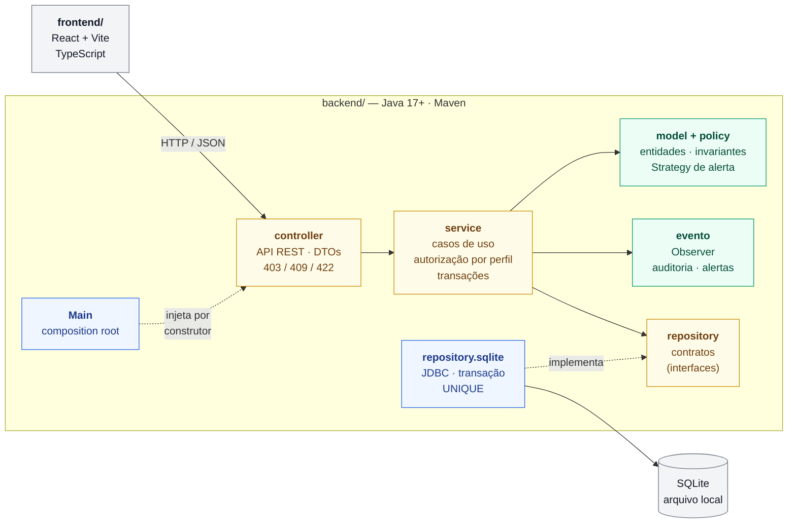
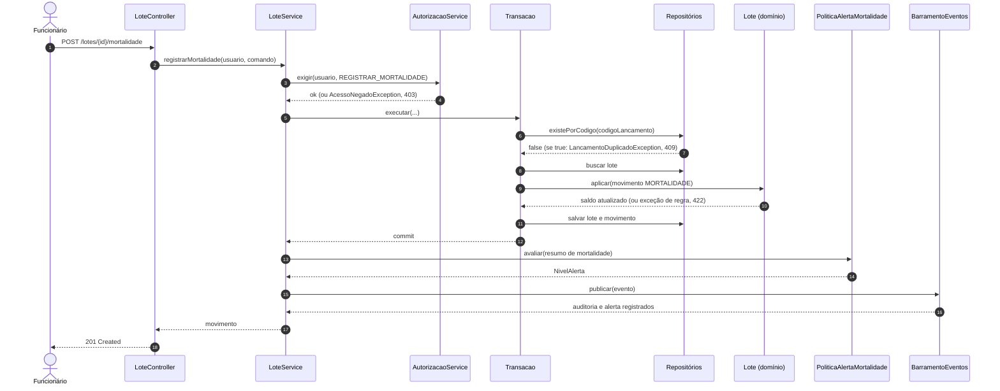

# Arquitetura — Sistema de Gestão para Granjas

> Parcial 01 · 11/11/2026 · decisões registradas em [ADR-001](adr/ADR-001-persistencia-sqlite.md) e [ADR-002](adr/ADR-002-camadas-e-regras-no-dominio.md)

## 1. Visão geral

O sistema é um **monorepo** com um backend Java (regras de negócio e API REST) e um frontend React. O backend segue uma arquitetura em camadas: o controller só traduz HTTP, o service orquestra o caso de uso e verifica a autorização, e as **regras de negócio ficam no domínio** (`model` e `policy`), onde os testes unitários as alcançam sem banco nem HTTP.



Imagem: [`img/arquitetura.png`](img/arquitetura.png)

## 2. Camadas, pacotes e dependências

Pacote raiz: `br.ufpb.aps.granja`.

| Camada | Pacote | Responsabilidade | Pode depender de |
|---|---|---|---|
| Controller | `controller` | Recebe HTTP, converte JSON em comandos, traduz exceções de domínio em status HTTP (403, 409, 422). Sem regra de negócio. | `service` |
| Service | `service` | Um método por caso de uso. Verifica a autorização por perfil, abre a transação, chama o domínio, grava, publica eventos. | `model`, `policy`, `repository`, `evento` |
| Domínio | `model`, `model.excecao` | Entidades, objetos de valor e **invariantes** (saldo, lote encerrado, insumo inativo). Não conhece banco, HTTP nem framework. | nada fora do JDK |
| Política | `policy` | Critérios de alerta substituíveis (Strategy). | `model` |
| Evento | `evento` | Barramento simples e ouvintes (Observer): auditoria e alertas. | `model` |
| Repositório | `repository` | **Contratos** de persistência e `Transacao`. | `model` |
| Infraestrutura | `repository.sqlite` | Implementação JDBC dos contratos. | `repository`, `model` |
| Composição | `Main` | Monta tudo e injeta as dependências **por construtor**. Única classe que conhece as implementações concretas. | todas |

Regra de dependência: as setas apontam para dentro. O domínio não importa nada das camadas acima. Isso permite testar cada regra em milissegundos, sem subir servidor ou banco.

### Estado de implementação em 11/11/2026

| Parte | Situação |
|---|---|
| `model`, `model.excecao`, `policy` | implementados, com 25 testes passando |
| `service`, `repository`, `repository.sqlite`, `evento`, `controller`, `Main` | desenhados (diagrama abaixo), implementação na Parcial 02 (24/11) |
| `frontend/` | feito pelo autor, fora do build Maven; telas sem backend mostram "não implementado" |

## 3. Diagramas de classes

Dois diagramas, para ficarem legíveis: [domínio](uml/diagramas.md) (implementado) e [aplicação](uml/diagramas.md) (planejado). Os fontes Mermaid estão em [`uml/`](uml/) e as imagens em [`img/`](img/).

## 4. Fluxo de uma operação: registrar mortalidade (UC06)



Pontos que sustentam as regras:
- **RN25**: a autorização é a primeira coisa que o service faz, antes de qualquer acesso a dados.
- **RN22**: a checagem do código e o `UNIQUE` no banco impedem o lançamento duplicado. A checagem dá a mensagem clara; o `UNIQUE` é a garantia final contra duas requisições simultâneas.
- **RN07, RN05**: quem recusa é o próprio `Lote.aplicar`, não o controller.
- **RN23**: movimento e saldo são gravados juntos; se algo falhar, a transação desfaz tudo.
- Os eventos são publicados **depois** do commit, para que nenhum ouvinte veja um estado que acabou desfeito.

Mapeamento de exceções para HTTP:

| Exceção | HTTP | Regra |
|---|---|---|
| `AcessoNegadoException` | 403 | RN25 |
| `LancamentoDuplicadoException` | 409 | RN22 |
| `SaldoInsuficienteException`, `LoteEncerradoException`, `InsumoInativoException` | 422 | RN07, RN05, RN19 |

## 5. Persistência

SQLite em arquivo local, acessado por JDBC puro (sem ORM), conforme o [ADR-001](adr/ADR-001-persistencia-sqlite.md).

Esboço das tabelas (Parcial 02):

| Tabela | Colunas principais | Restrições |
|---|---|---|
| `usuario` | id, login, senha_hash, perfil, ativo | `login` UNIQUE |
| `lote` | id, codigo, especie, quantidade_inicial, saldo, status | `codigo` UNIQUE; `saldo >= 0` |
| `movimento_lote` | id, lote_id, tipo, quantidade, codigo_lancamento, data_hora, observacao | **`codigo_lancamento` UNIQUE**; `quantidade > 0`; FK para `lote` |
| `insumo` | id, nome, categoria, unidade, nivel_minimo, saldo, ativo | `saldo >= 0` |
| `movimento_estoque` | id, insumo_id, tipo, quantidade, codigo_lancamento, origem | **`codigo_lancamento` UNIQUE**; `quantidade > 0`; FK para `insumo` |
| `registro_alimentacao` | id, lote_id, insumo_id, quantidade, data, codigo_lancamento | FKs para `lote` e `insumo` |

`Transacao.executar(Supplier<T>)` abre a transação JDBC, executa o bloco e faz commit; qualquer exceção provoca rollback.

## 6. Padrões de projeto

| Padrão | Categoria GoF | Onde | Por quê | Situação |
|---|---|---|---|---|
| **Strategy** | Comportamento | `PoliticaAlertaMortalidade` com `AlertaMortalidadeDiaria` e `AlertaMortalidadeAcumulada` | O desafio pede variar a política de alerta por limite sem mexer em quem a usa. Trocar de critério é trocar a instância. | implementado, testado |
| **Observer** | Comportamento | `BarramentoEventos`, `AuditoriaListener`, `AlertaListener` | Auditoria e alertas reagem a um evento sem que o service conheça cada ouvinte. | 24/11 |
| **Factory Method** | Criação | `CriadorPoliticaAlerta` com `CriadorAlertaDiario` e `CriadorAlertaAcumulado` | O PDF exige duas categorias diferentes. Strategy é de comportamento; Factory Method é de criação. O Gestor escolhe o critério e o serviço recebe só a interface. | implementado, testado (T23–T25) |

## 7. Monorepo

```
/
├── pom.xml            POM agregador (permite rodar `mvn test` na raiz)
├── backend/           Java 17+ · Maven · JUnit 5
├── frontend/          React + Vite + TypeScript (fora do build Maven)
└── docs/              requisitos, arquitetura, UML, ADRs, matriz, uso de IA
```

O backend compila com `release 17` e foi testado com JDK 21. As bibliotecas de API REST, SQLite, JSON e bcrypt entram no POM do backend na Parcial 02.
