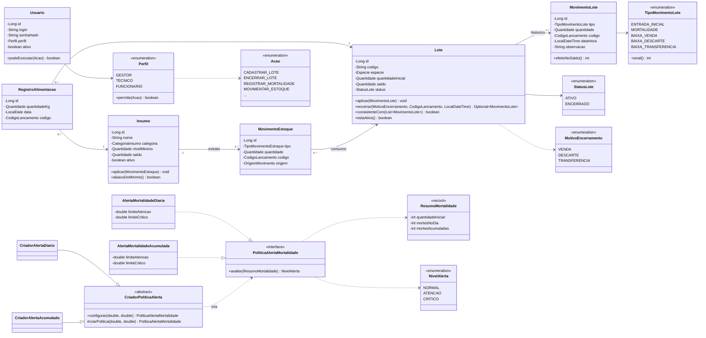
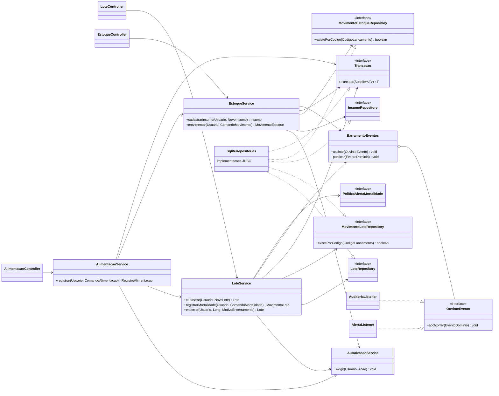

# Diagramas UML

Os fontes ficam em [`uml/*.mmd`](.) e as imagens renderizadas em [`../img/`](../img/). O GitHub desenha os blocos Mermaid abaixo diretamente.

## 1. Domínio e políticas (implementado)

Corresponde às classes de `backend/src/main/java/br/ufpb/aps/granja/model` e `.../policy`. Imagem: [`classes-dominio.png`](../img/classes-dominio.png).

## 2. Aplicação (planejado para 24/11)

Serviços, repositórios, transação e eventos. **Ainda não há código** para estas classes. Imagem: [`classes-aplicacao.png`](../img/classes-aplicacao.png).

## 3. Arquitetura em camadas

Ver [`../arquitetura.md`](../arquitetura.md).
